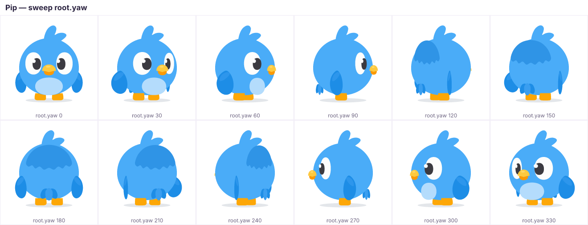
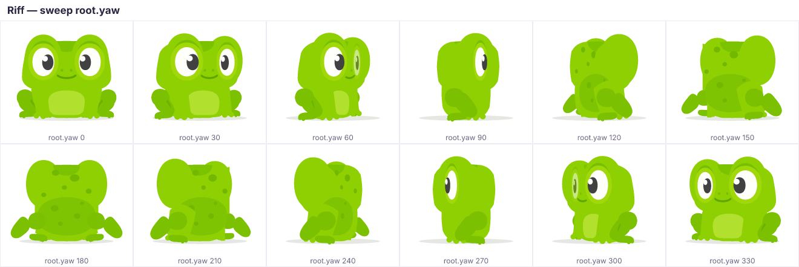

# OpenMascot

**An open-source engine for rigged, animated SVG brand mascots.** Draw your
character once as a layered SVG, annotate a few pivots, and get a lively,
Duolingo-style mascot that blinks, breathes, glances around, emotes, dances,
turns in pseudo-3D and throws hearts and confetti — in a few kilobytes, with
no proprietary editor and no video files.

**[▶ Live demo](https://jbraunschweiger.github.io/openmascot/)** —
[Studio](https://jbraunschweiger.github.io/openmascot/#/studio) ·
[Gallery](https://jbraunschweiger.github.io/openmascot/#/gallery) ·
[App showcase](https://jbraunschweiger.github.io/openmascot/#/app)

<p align="center">
  
</p>

<p align="center">
  
</p>

<p align="center">
  
</p>

<p align="center">
  
  
</p>

> Status: **0.1.0** — the first npm release (`@openmascot/*`) is being
> prepared; until it is published, use the packages from this monorepo. React
> Native support is on the roadmap.

## Why

Brand mascots that *react* — celebrating a streak, nodding at a right answer,
sulking at a wrong one — make products feel alive. Today that usually means a
Rive/Lottie pipeline, an animator, and a binary file per animation. OpenMascot
takes a different route:

- **The character is one plain SVG.** It previews in any browser, Figma or
  Inkscape. A handful of `data-om-*` attributes say how it moves.
- **Animations are plain data.** Clips are JSON-serialisable keyframes that
  address standard bone names and portable *params* (`lookX`, `flap`,
  `squash`…), so one library of emotions and dances works across characters.
- **Fake 3D for free.** A 2.5D solver turns a single front-view drawing into a
  character that can spin 360°, look around and nod, with parallax,
  foreshortening, back-face culling and depth sorting.
- **Built for humans _and_ AI agents.** Everything is text: SVG, TypeScript
  data, and a CLI that renders **frame sheets** (contact sheets of an
  animation) so a reviewer — or a multimodal model — can check motion at a
  glance.
- **Deterministic.** Same seed, same frames. Great for tests, sheets and video
  export.

## Features

- Annotated-SVG rig format: bones, pivots, depth, surfaces, swappable slots
  (eyes, mouths, wing poses), spring bones, ground shadow — see
  [docs/rig-format.md](docs/rig-format.md).
- Crossfaded clip playback with one-shots, loops, repeats, speed, beat-synced
  dances (`bpm`), and `then` chaining.
- "Alive" layers: breathing, randomised blinks (with double blinks), idle
  glances, idle fidgets, pointer/look-at tracking.
- Expressions with **blink-masked eye swaps** (the eyes change behind a blink,
  like a 2D animator would do it).
- Spring secondary motion for ears, tufts and wings.
- 20+ built-in particle effects (hearts, sparkles, notes, sweat, tears,
  confetti, zzz, speed lines…) that are analytic and deterministic — see
  [docs/effects.md](docs/effects.md).
- Renderers: live DOM renderer (minimal attribute diffing), `<open-mascot>`
  custom element, React `<Mascot>` component, and a string renderer for SSR,
  snapshots and frame sheets.
- A CLI to validate rigs, lint clips, render frames and build frame sheets.
- Three ready-made characters — Echo the bat, Pip the bird and Riff the frog —
  sharing one portable library of 60+ clips (emotes, gestures, 19 dances).

## Quick start

### Install

```bash
npm install @openmascot/react @openmascot/characters    # React
npm install @openmascot/web @openmascot/characters      # custom element / vanilla DOM
npm install @openmascot/core @openmascot/characters     # engine only (Node, workers, SSR)
```

(`pnpm add …` / `yarn add …` work the same.) Every package ships ESM + CommonJS
builds with TypeScript types and works with any bundler. Import a single
character from its subpath — `@openmascot/characters/echo` — to keep the other
characters out of your bundle. The CLI runs without installing:
`npx @openmascot/cli validate echo`.

### React

```tsx
import { Mascot, useMascotRef } from '@openmascot/react';
import { echo } from '@openmascot/characters/echo';

export function Buddy() {
  const ref = useMascotRef();
  return (
    <div>
      <Mascot ref={ref} character={echo} animation="idle" lookAtPointer style={{ width: 240 }} />
      <button onClick={() => ref.current?.play('emote-celebrate')}>Celebrate</button>
      <button onClick={() => ref.current?.emit('hearts')}>Love</button>
    </div>
  );
}
```

### Custom element (no framework, no build step)

```html
<open-mascot character="echo" animation="dance-bop" bpm="110" look-at-pointer style="width:240px"></open-mascot>

<script type="module">
  import { defineOpenMascot } from '@openmascot/web';
  import { echo } from '@openmascot/characters/echo';
  defineOpenMascot({ characters: { echo } });

  const el = document.querySelector('open-mascot');
  el.addEventListener('mascot:end', (e) => console.log('finished', e.detail.clip));
  el.play('wave');
</script>
```

Without a bundler, load the modules from a CDN. [esm.sh](https://esm.sh)
resolves the dependencies for you:

```html
<open-mascot character="echo" animation="wave" style="width:240px"></open-mascot>
<script type="module">
  import { defineOpenMascot } from 'https://esm.sh/@openmascot/web@0.1.0';
  import { echo } from 'https://esm.sh/@openmascot/characters@0.1.0/echo';
  defineOpenMascot({ characters: { echo } });
</script>
```

With [unpkg](https://unpkg.com) (or jsDelivr), map the bare imports with an
import map:

```html
<script type="importmap">
  {
    "imports": {
      "@openmascot/core": "https://unpkg.com/@openmascot/core@0.1.0/dist/index.js",
      "@openmascot/web": "https://unpkg.com/@openmascot/web@0.1.0/dist/index.js",
      "@openmascot/characters/echo": "https://unpkg.com/@openmascot/characters@0.1.0/dist/echo/index.js"
    }
  }
</script>
<script type="module">
  import { defineOpenMascot } from '@openmascot/web';
  import { echo } from '@openmascot/characters/echo';
  defineOpenMascot({ characters: { echo } });
</script>
```

### Vanilla core (any renderer, Node, workers)

```ts
import { Mascot, renderSvg } from '@openmascot/core';
import { echo } from '@openmascot/characters';

const m = new Mascot(echo, { seed: 42 });
m.play('emote-love');
for (let i = 0; i < 30; i++) m.update(1 / 60); // advance half a second
const svg = renderSvg(m.rig, m.current.frame, { padding: 40, particles: m.current.particles });
```

In the browser, pair the core with `DomRenderer` (or just use
`MascotPlayer` from `@openmascot/web`, which owns the animation loop). See
[docs/api.md](docs/api.md).

## How it works

```
 echo.svg (annotated) ──compileRig──▶ Rig
                                       │
 clips + alive layers ──Mascot.update──▶ Pose ──resolvePose──▶ bone channels ──solve (2.5D)──▶ Frame
                                                                                                │
                                   DomRenderer · renderSvg · (React Native, planned) ◀──────────┘
```

Read [docs/architecture.md](docs/architecture.md) for the full pipeline and
[docs/pseudo-3d.md](docs/pseudo-3d.md) for the 2.5D model.

## Packages

| package | what it is | min+gzip |
|---|---|---:|
| [`@openmascot/core`](packages/core) | DOM-free engine: XML parser, rig compiler, 2.5D solver, clips, poses, effects, runtime, string renderer, authoring helpers. Zero dependencies. | 20.6 kB |
| [`@openmascot/web`](packages/web) | Browser runtime: `DomRenderer`, `MascotPlayer` (rAF loop, visibility pausing, reduced motion, pointer tracking), `<open-mascot>` element. | 3.1 kB (+ core) |
| [`@openmascot/react`](packages/react) | `<Mascot>` component and `useMascotRef()` imperative handle. | 0.9 kB (+ web, core) |
| [`@openmascot/characters`](packages/characters) | Characters and the shared clip library (idle, fidgets, emotions, gestures, dances). One subpath per character: `/echo`, `/pip`, `/riff`, plus `/library`. | 12.3 kB library + ~8–11 kB art per character |
| [`@openmascot/cli`](packages/cli) | `openmascot validate / list / lint / render / framesheet` (`npx @openmascot/cli`). | — |
| [`apps/playground`](apps/playground) | Vite + React playground: studio, gallery and an app showcase (not published). | — |

Sizes are upper bounds for importing everything an entry exports (minified,
gzip -9; `@openmascot/characters/echo` including the library is 20.8 kB). An
app with React, Echo and the full engine adds about 45 kB gzipped. Run
`pnpm build && pnpm size` for current numbers.

## Scripts

Requires Node 22+ and pnpm 10.

| command | does |
|---|---|
| `pnpm install` | install the workspace |
| `pnpm dev` | run the playground at http://localhost:5173 |
| `pnpm test` | unit tests (Vitest) |
| `pnpm typecheck` | `tsc --noEmit` over all packages and tests |
| `pnpm embed` / `pnpm embed --check` | regenerate / verify `art.generated.ts` from each character SVG |
| `pnpm check` | `embed --check` + `typecheck` + `test` (what CI runs first) |
| `pnpm openmascot <cmd>` | the CLI (`validate`, `list`, `lint`, `render`, `framesheet`) |
| `pnpm framesheet echo <clip>` | contact sheet of a clip → `out/sheets/` |
| `pnpm build` | build the npm packages (`dist/`, ESM + CJS + types) with tsup |
| `pnpm build:playground` | build the playground |
| `pnpm size` | minified + gzipped size of every published entry point |
| `pnpm smoke:pack` | pack the packages and test the tarballs in a fresh consumer project |
| `pnpm changeset` | describe a change for the next release (see [CONTRIBUTING.md](CONTRIBUTING.md#publishing)) |

## Documentation

Start at [docs/README.md](docs/README.md). Highlights:

- [Rig format](docs/rig-format.md) — how to annotate an SVG
- [Authoring a character](docs/characters.md) — step by step, written so an AI agent can follow it
- [Animation](docs/animation.md) — clips, params, expressions, dances
- [Pseudo-3D](docs/pseudo-3d.md) — how a flat drawing turns around
- [Effects](docs/effects.md) — built-in particles and custom effects
- [API reference](docs/api.md)
- [Mobile plan](docs/mobile.md) — React Native and native exports
- [Testing & visual review](docs/testing.md)

## Roadmap

- [x] Annotated-SVG rig format, compiler and validator
- [x] 2.5D solver (parallax, foreshortening, culling, depth sort, perspective)
- [x] Runtime: crossfades, alive layers, expressions, springs, effects
- [x] Web: DOM renderer, custom element, React component
- [x] CLI frame sheets for visual review; Echo, Pip and Riff
- [x] Release tooling: tsup builds, per-character subpath exports, changesets
- [ ] Publish packages to npm (0.1.0)
- [ ] React Native renderer over `react-native-svg` ([plan](docs/mobile.md))
- [ ] More characters (Tootie, Ziggy, Forte), and a character template
- [ ] Lip-sync / talking mouth driven by audio amplitude or visemes
- [ ] Video / GIF / sprite-sheet export; Lottie export for native players
- [ ] Visual rig editor in the playground (pivot picking, live z-ordering)

## Contributing

Contributions are welcome — new characters, clips, effects, renderers, docs.
Please read [CONTRIBUTING.md](CONTRIBUTING.md) and our
[Code of Conduct](CODE_OF_CONDUCT.md). AI coding agents should start with
[AGENTS.md](AGENTS.md).

## Licence

[MIT](LICENSE) — code and the bundled Echo character art.
