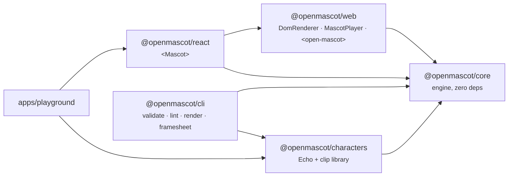

# Architecture

OpenMascot is a small, layered engine. Everything up to the final draw call is
**pure TypeScript with no DOM access**, so the same core runs in browsers,
Node (SSR, CLI, tests), web workers and — planned — React Native.

## Packages



| package | key files |
|---|---|
| core | `xml.ts` (parser/serialiser) · `rig.ts` (annotated SVG → `Rig`) · `clip.ts` (keyframe sampling, lint) · `ease.ts` · `pose.ts` (blend, layer, resolve params/expressions) · `solve.ts` (2.5D solver) · `mat.ts` · `effects.ts` + `effects-library.ts` · `mascot.ts` (runtime) · `render-string.ts` · `author.ts` (clip helpers) · `types.ts` |
| web | `dom-renderer.ts` · `player.ts` · `element.ts` |
| react | `index.tsx` |
| characters | `echo/echo.svg` → `echo/art.generated.ts` (via `scripts/embed-svg.mjs`), `echo/index.ts` (CharacterDef), `echo/clips.ts`, `library/*.ts` |
| cli | `bin.ts`, `sheet.ts` (frame sheets), `fx-sheet.ts` (effects review sheet) |

## The pipeline

```
                ┌───────────── once, at construction ─────────────┐
 annotated SVG ─┤ parseXml → compileRig → Rig (bones, slots, art) │
                └──────────────────────────────────────────────────┘

                ┌──────────────────── every update(dt) ─────────────────────────────┐
 clip tracks  ──┤ sampleClip per track → blendPoses (crossfade weights) → Pose        │
 alive layers ──┤ + breathe, blink, glance/look-at, fidgets, param overrides          │
 expression   ──┤ + expression override                                               │
                │ resolvePose: params → bone channel deltas, expression → slot map    │
                │ blink-masking of eye-slot swaps · shadow follows root               │
                │ solve(rig, channels, slots, spring angles) → Frame                  │
                │ stepSprings(frame) → spring angles for the next update              │
                │ particles: analytic state at `now` (following bones if needed)      │
                └───────────────────────────────────────────────────────────────────────┘
                                         │ MascotFrame { time, frame, particles }
             ┌───────────────────────────┼──────────────────────────┐
        DomRenderer               renderSvg (string)        react-native-svg (planned)
```

### 1. Compile: `compileRig(svg, { recolor, warnings })`

`parseXml` is a tiny dependency-free XML parser (no `DOMParser`, so it works
everywhere). `compileRig` walks the tree:

- `<g data-om-bone>` → `BoneNode` (pivot, z, surface, normal, spring, shadow);
- `<g data-om-slot>` → `SlotNode` with `variants` (children marked
  `data-om-variant`), default = first or `data-om-default`;
- `<g data-om-layer>` → `LayerNode` (static, depth-sortable);
- every run of other markup → one pre-serialised `ArtNode`;
- root `<defs>` are hoisted into `rig.defs`.

Every node gets a unique `index` (used as the key of draw-order maps), every
bone instance a `bi` (index into `Frame.bones`). The same bone name may occur
in several variants of a slot (e.g. a `pupil-l` in each eye shape); all
instances receive the same pose. Non-fatal problems (unannotated groups that
contain bones, z-order vs document order, missing `root`…) are collected as
warnings; malformed annotations throw `RigError`.

### 2. Animate: `Mascot.update(dt)`

`Mascot` (core/`mascot.ts`) owns:

- **Tracks** — one per `play()`; each has a weight that ramps toward its
  target over the crossfade (`fade` / `clip.fadeIn`, default 0.25 s). Tracks
  are sampled and blended in order with `blendPoses`. One-shots end, fire
  `end`, resolve their promise and continue with `then` (default: idle).
  Loops honour `repeat`. Beat clips convert beats to seconds with `bpm`.
- **Clip events** — fired exactly once per loop iteration for the dominant
  (incoming) track only, including events at `t = 0`.
- **Alive layers** — breathing (`breathe` param), randomised blinks with
  occasional double blinks, idle glances, fidget clips during idle,
  `lookAt` easing. Clips can `suppress` any of these while dominant.
- **Expression override** — `setExpression(name, duration?)`.
- **Springs** — a small point-mass simulation per spring bone (sub-stepped at
  240 Hz) whose angle feeds back into the next solve as `extraRot`.
- **Particles** — spawned by `emit()` or clip events; see [effects.md](effects.md).

### 3. Resolve: `resolvePose(character, rig, pose)`

Params are clamped to `[min, max]`, then each driver adds `value × k` (or a
piecewise-linear `curve`) to a bone channel. Slots start from each slot's
default, then `neutral`, then the active expression, then explicit slot
overrides; unknown variants fall back to the default so a typo never blanks
out a face.

### 4. Solve: `solve(rig, input, opts)`

The 2.5D solver (see [pseudo-3d.md](pseudo-3d.md)) walks the rig once and
produces, per bone instance, a **local** 2D affine matrix (relative to its
parent group — exactly what an SVG `transform` needs), a world matrix,
opacity, depth and accumulated yaw/pitch. For every container whose children
are no longer in depth order it records a permutation in `Frame.order`.

### 5. Render

- **`DomRenderer`** builds the SVG DOM **once** (one `<g>` per node, all slot
  variants present with `display="none"`), then each frame only writes
  attributes that changed: `transform`, `opacity`/`visibility`, slot
  `display`, child order (re-appended only when the order signature changes),
  and particle groups.
- **`renderSvg`** serialises a frame to a standalone SVG string (used by the
  CLI, SSR, snapshot tests). Hidden variants and fully transparent bones are
  omitted.
- A **React Native** renderer can consume the very same `Frame` — see
  [mobile.md](mobile.md).

## Data model

All character and animation data is plain JSON-serialisable data, except the
optional procedural `clip.fn` hook and effect `spawn` functions:

```ts
CharacterDef { id, name, svg, expressions, params?, clips?, palette?, anchors?, idle?, meta? }
Clip         { duration, units?, bpm?, loop?, bones?, params?, expression?, slots?, events?, suppress?, fadeIn?, fn? }
Pose         { bones: { [bone]: Partial<BoneChannels> }, params, slots, expression? }
Frame        { bones: SolvedBone[], slots, order: Map<containerIndex, childOrder> }
```

Bone channels in a pose are offsets from rest for `x y rot yaw pitch dz` and
absolute factors for `sx sy opacity` (rest = 1). That makes "rest" the empty
pose, makes blending against a missing channel well defined, and lets
additive layers add offsets and multiply factors.

## Determinism

`Mascot` is deterministic for a given `seed` and sequence of calls:

- all randomness (blink timing, glances, fidget choice, effect spawns, the
  `ctx.random` handed to procedural clips) comes from seeded `mulberry32`
  generators (`rng(seed)` in `effects.ts`); each track and each effect
  emission derives its own sub-seed;
- particles are **analytic** — each one's state is a pure function of its age —
  so there is no simulation drift;
- the only integrated state is look easing and springs, which depend only on
  the `dt` sequence.

Tests assert that two mascots with the same seed produce byte-identical SVG
for hundreds of frames. Frame sheets use `alive: false` and a fixed seed so
they are reproducible. `update(dt)` clamps `dt` to `[0, 0.25]`.

## Performance notes

- **Compile once.** `compileRig` runs at construction; per-frame work is a
  single tree walk (O(bones + nodes)), a handful of small allocations per
  bone, and string formatting of matrices.
- **Minimal DOM writes.** `DomRenderer` caches the last transform/opacity
  string per bone and the last order signature per container; a still
  character costs almost nothing. Elements are never recreated per frame
  (except particles, which are created once and removed when they expire).
- **Hidden variants are solved too** (cheap) so their transforms are valid the
  moment they become visible, but they never get a draw order.
- **Analytic particles** cost a function call each per frame, no physics.
- **Pausing.** `MascotPlayer` stops its `requestAnimationFrame` loop when the
  element is off-screen (`IntersectionObserver`) or the tab is hidden, clamps
  long frames to 0.1 s, and honours `prefers-reduced-motion` (no autonomous
  life unless you opt in).
- **Size.** Echo's SVG is embedded as a string module (`art.generated.ts`), so
  no loader or fetch is needed in any bundler.

## Extension points

| want to… | do this |
|---|---|
| add a character | write an annotated SVG + `CharacterDef` ([characters.md](characters.md)) |
| add animations | write `Clip` data; use params for portability ([animation.md](animation.md)) |
| add particle effects | pass `effects: { name: EffectDef }` to `Mascot` ([effects.md](effects.md)) |
| theme / recolour | `recolor: { '#634c91': '#2a9d8f' }` at construction |
| render elsewhere | consume `MascotFrame` (see `render-string.ts` for a 90-line reference renderer) |
| tune the 3D look | `solve: { focal, faceForeshorten }` |
