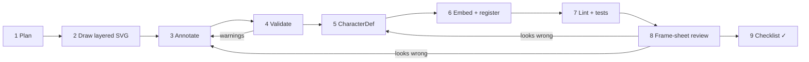

# Authoring a new character

This is a step-by-step recipe for adding a character to OpenMascot. It is
written so that **an AI coding agent can follow it literally** — every step has
a concrete command and a concrete "done when" check — but it works just as
well for a human illustrator with a text editor.

Echo the bat (`packages/characters/src/echo/`) is the reference
implementation; open it side by side.



Throughout, `<id>` is your character's id (lowercase, e.g. `pip`).

---

## Step 1 — Plan the rig

Write down, before drawing:

1. **Bone tree** using the standard names (so the shared clip library works):

   ```
   shadow                      (outside root)
   root                        pivot at the ground point (0, 0)
   └─ body                     pivot near the hips / centre of mass
      ├─ wing-l / arm-l        pivot at the shoulder, z < 0 (behind the body)
      ├─ wing-r / arm-r
      ├─ foot-l, foot-r        pivot at the ankle, z slightly < 0
      ├─ head                  pivot at the neck, z slightly > 0
      │  ├─ ear-l, ear-r, tuft spring bones, flat
      │  ├─ eye-l, eye-r       face bones; contain the eye slots; pupils inside
      │  ├─ mouth              face bone; contains the mouth slot
      │  └─ nose               feature bone (snout/beak)
      └─ belly                 face bone (optional)
   ```

   `-l` / `-r` mean **screen** left / right. Use only the bones your design
   needs, but don't rename the standard ones. The shared clip library
   currently addresses `root body head ear-l ear-r tuft wing-l wing-r foot-l
   foot-r` directly (everything else goes through params), so a character
   with arms should still call its forelimbs `wing-l`/`wing-r` — or ship its
   own versions of the clips that move them. `pnpm openmascot lint <id>`
   lists every clip that references a bone your rig lacks.

2. **Slots and variants** — the swappable art. Minimum for the expression
   library: `eye-l`, `eye-r` (`open happy closed heart half angry sad
   surprised dizzy`), `mouth` (`default smile open tongue o frown grin`),
   optionally `blush` (`off on`) and limb poses (`wing-l`/`wing-r`:
   `spread folded`).

3. **Depth (`z`) of every bone** relative to its parent pivot (see
   [pseudo-3d.md](pseudo-3d.md#designing-art-that-turns-well)).

**Done when:** you have a tree like the one above with names, approximate
pivots, `z` values and surfaces.

## Step 2 — Draw the layered SVG

Create `packages/characters/src/<id>/<id>.svg`. Rules (from
[rig-format.md](rig-format.md)):

- **Coordinates:** `(0, 0)` is the ground point under the character; the
  character lives at negative `y`. Aim for roughly **250–300 units tall** and
  a head ~150 units wide — effects and the clip library are tuned for that
  scale (Echo: `viewBox="-212 -242 424 252"`).
- **One `<g>` per part**, nested like the bone tree, **back to front in
  document order**.
- **Front view, neutral pose**, arms/wings in their default position, eyes
  open, mouth `default`.
- Flat, simple shapes. Avoid filters and heavy gradients (they cost
  performance and don't foreshorten well); `<defs>` at the root are fine.
- Each slot variant is its own `<g>`; give non-default variants
  `display="none"` so the file previews correctly.
- Draw left/right parts as exact mirrors (negate `x`). A generator script
  like `packages/characters/scripts/echo-src.py` is a good way to guarantee
  this, but the SVG is the deliverable and may be hand-edited.

**Done when:** the SVG opens in a browser and looks like the finished
character in its rest pose.

## Step 3 — Annotate

Add `data-om-*` attributes (full reference: [rig-format.md](rig-format.md)):

```xml
<svg xmlns="http://www.w3.org/2000/svg" viewBox="-200 -280 400 300" data-om-character="pip">
  <g data-om-bone="shadow" data-om-shadow=""><ellipse rx="70" ry="8" fill="#2a1f40" opacity=".12"/></g>
  <g data-om-bone="root" data-om-pivot="0 0">
    <g data-om-bone="body" data-om-pivot="0 -75">
      <g data-om-bone="wing-l" data-om-pivot="-60 -100" data-om-z="-20" data-om-surface="flat"
         data-om-spring="90 9" data-om-tip="-150 -80"> … </g>
      <g data-om-bone="wing-r" data-om-pivot="60 -100" data-om-z="-20" data-om-surface="flat"
         data-om-spring="90 9" data-om-tip="150 -80"> … </g>
      <g data-om-bone="foot-l" data-om-pivot="-23 -24" data-om-z="-6"> … </g>
      <g data-om-bone="foot-r" data-om-pivot="23 -24" data-om-z="-6"> … </g>
      <path d="…body…" fill="#2a9d8f"/>
      <g data-om-bone="head" data-om-pivot="0 -140" data-om-z="4">
        <circle cy="-150" r="75" fill="#2a9d8f"/>
        <g data-om-bone="eye-l" data-om-pivot="-40 -150" data-om-z="40" data-om-surface="face" data-om-normal="-22 0">
          <g data-om-slot="eye-l">
            <g data-om-variant="open">
              <circle cx="-40" cy="-150" r="18" fill="#fff"/>
              <g data-om-bone="pupil-l" data-om-pivot="-40 -150" data-om-z="6"><circle cx="-40" cy="-150" r="8"/></g>
            </g>
            <g data-om-variant="happy" display="none"> … </g>
            …
          </g>
        </g>
        …
        <g data-om-bone="mouth" data-om-pivot="0 -105" data-om-z="45" data-om-surface="face">
          <g data-om-slot="mouth">
            <g data-om-variant="default"> … </g>
            <g data-om-variant="smile" display="none"> … </g>
            …
          </g>
        </g>
        <g data-om-bone="nose" data-om-pivot="0 -125" data-om-z="66" data-om-surface="feature"> … </g>
      </g>
    </g>
  </g>
</svg>
```

Checklist while annotating:

- every pivot is an **absolute** coordinate read off the drawing;
- `z` values are relative to the parent pivot, document order matches `z`;
- eyes/mouth/blush/belly are `face`, snout/beak is `feature`, ears/wings are
  `flat`, round masses are `volume` (default), back details are `back`;
- springs on light appendages (`data-om-spring="stiffness damping"`, with a
  `data-om-tip` at the far end): ears ~`140 10`, tufts ~`160 9`, wings ~`90 9`;
- the same bone name (e.g. `pupil-l`) may appear in several variants of a slot.

## Step 4 — Validate the rig

```bash
pnpm openmascot validate packages/characters/src/<id>/<id>.svg
```

It prints the bone tree and every warning: unannotated groups that contain
bones, z-order that disagrees with document order, duplicate bones outside
slots, missing `root`, slot children without `data-om-variant`, non-`<g>` rig
nodes. Malformed annotations (bad numbers, unknown surfaces, duplicate slots
or variants) are hard errors.

**Done when:** `✓ no warnings`.

## Step 5 — Write the `CharacterDef`

Create `packages/characters/src/<id>/index.ts` (copy Echo's):

```ts
import type { CharacterDef } from '@openmascot/core';
import svg from './art.generated';
import { library } from '../library';

export const pip: CharacterDef = {
  id: 'pip',
  name: 'Pip',
  svg,
  // slot → variant maps. `neutral` must set every face slot.
  expressions: {
    neutral: { 'eye-l': 'open', 'eye-r': 'open', mouth: 'default', blush: 'off' },
    happy: { 'eye-l': 'happy', 'eye-r': 'happy', mouth: 'smile' },
    // … implement every expression the clip library uses (see the checklist)
  },
  // Portable params → this character's bones.
  params: {
    lookX: { min: -1.5, max: 1.5, drives: [
      { bone: 'head', channel: 'yaw', k: 24 },
      { bone: 'pupil-l', channel: 'x', k: 4.5 },
      { bone: 'pupil-r', channel: 'x', k: 4.5 },
    ] },
    lookY: { min: -1.5, max: 1.5, drives: [{ bone: 'head', channel: 'pitch', k: 14 }] },
    blink: { min: 0, max: 1, drives: [
      { bone: 'eye-l', channel: 'sy', k: -0.9 },
      { bone: 'eye-r', channel: 'sy', k: -0.9 },
    ] },
    breathe: { drives: [{ bone: 'body', channel: 'sy', k: 0.012 }] },
    squash: { min: -1, max: 1, drives: [
      { bone: 'root', channel: 'sy', k: -0.2 },
      { bone: 'root', channel: 'sx', k: 0.16 },
    ] },
    flap: { min: -1.5, max: 1.5, drives: [
      { bone: 'wing-l', channel: 'rot', k: 34 },
      { bone: 'wing-r', channel: 'rot', k: -34 },
    ] },
    lean: { min: -1.5, max: 1.5, drives: [{ bone: 'body', channel: 'rot', k: 12 }] },
  },
  clips: { ...library },               // + character-only clips
  anchors: {                           // where effects attach
    head: { bone: 'head', offset: [0, -10] },
    mouth: { bone: 'mouth' },
    feet: { bone: 'root' },
  },
  idle: { clip: 'idle', blinkEvery: 3.2, fidgetEvery: 7,
          fidgets: ['fidget-ear-twitch', 'fidget-look-around', 'fidget-wing-stretch', 'fidget-hop'] },
  palette: { body: '#2a9d8f' },        // colours used in the SVG, for theming
  meta: { description: 'A cheerful …', license: 'MIT' },
};
export default pip;
```

Notes:

- **Params are the portability layer.** The library animates `lookX lookY
  blink breathe squash flap lean`; map each one onto your bones. Drivers add
  `value × k` (or a piecewise-linear `curve: [[param, delta], …]`) to a
  channel. Tune `k` with a param sweep (step 8).
- `blink` must close the eyes (scale `sy` of the eye bones toward 0) — the
  runtime hides eye-slot swaps behind blinks.
- Effects default to the `head` anchor, so define it.
- Character-only clips (poses that rely on unique anatomy) go in
  `src/<id>/clips.ts` and are merged over the library.

## Step 6 — Embed and register

```bash
pnpm embed            # writes src/<id>/art.generated.ts from src/<id>/<id>.svg
```

Then add the character to the registry in
`packages/characters/src/index.ts`:

```ts
export { pip } from './pip';
import { pip } from './pip';
export const characters: Record<string, CharacterDef> = { echo, pip };
```

The CLI and playground find characters through this registry.

**Done when:** `pnpm embed --check` and `pnpm typecheck` pass. Re-run
`pnpm embed` after **every** SVG edit.

## Step 7 — Lint and test

```bash
pnpm openmascot validate <id>     # rig + expressions + param drivers
pnpm openmascot lint <id>         # every clip vs this rig, params, expressions, effects
pnpm openmascot list <id>         # clips by category, expressions, effects
```

Add a test file `packages/characters/test/<id>.test.ts` modelled on
`echo.test.ts` (compiles with zero warnings, expressions reference real
variants, params drive real bones, every clip lints). Run `pnpm test`.

**Done when:** all three commands are clean and `pnpm test` passes.

## Step 8 — Frame-sheet review loop

Frame sheets are PNG contact sheets rendered by the real engine. Look at them
(a multimodal agent can read the PNGs directly), fix, repeat.

```bash
# the rest pose and every expression
pnpm framesheet <id> --expressions
# 3D turn: wings/ears must mirror, face must fade by ~100°, back must appear
pnpm framesheet <id> --sweep root.yaw --range 0,330
pnpm framesheet <id> --sweep head.yaw --range -90,90 --frames 7
pnpm framesheet <id> --sweep head.pitch --range -30,30 --frames 7
# each param across its range
pnpm framesheet <id> --param lookX --range -1,1 --frames 7
pnpm framesheet <id> --param flap --range -1.5,1.5 --frames 7
pnpm framesheet <id> --param squash --range -1,1 --frames 5
# representative clips, and transitions
pnpm framesheet <id> idle --frames 8
pnpm framesheet <id> emote-love --frames 12
pnpm framesheet <id> dance-spin --frames 12
pnpm framesheet <id> wave --from idle
```

Output goes to `out/sheets/<id>-*.png`. What to look for:

| symptom | likely fix |
|---|---|
| part pops in front of / behind something mid-turn | adjust its `data-om-z` (or the neighbour's) |
| eye/mouth visible from behind | make it `surface="face"` |
| snout disappears in profile | make it `surface="feature"` |
| wing becomes a thin stripe | it's `flat` and edge-on: expected; it fades out — keep turns brisk |
| pupils leave the eye on `lookX` | lower the pupil `k` |
| parts drift apart at `flap` extremes | move the pivot to the true joint |
| expression shows the wrong eye | wrong variant name in `expressions` |
| ears jitter or flop | soften the spring (lower stiffness, raise damping) |

You can also run the playground (`pnpm dev`) to scrub clips live.

## Step 9 — Final checklist

- [ ] `<id>.svg` previews correctly in a browser (rest pose, defaults visible).
- [ ] `pnpm openmascot validate <id>` → no warnings.
- [ ] Bones use the standard names; `-l`/`-r` are screen-left/right and mirror each other.
- [ ] `neutral` sets every face slot; all expressions used by the library exist:
      `neutral happy joyful excited love inlove unimpressed playful wink determined
      sad surprised singing dizzy sleepy proud` (run `pnpm openmascot lint <id>` —
      it reports unknown expressions).
- [ ] All standard params are implemented: `lookX lookY blink breathe squash flap lean`.
- [ ] Anchors `head`, `mouth`, `feet` exist.
- [ ] `pnpm embed --check`, `pnpm typecheck`, `pnpm test`, `pnpm openmascot lint <id>` pass.
- [ ] Sweep sheets: clean 360° turn, sensible look and nod.
- [ ] Expression sheet: every expression reads clearly at small size.
- [ ] A few clip sheets (idle, an emotion, a dance, a gesture) look right.
- [ ] `meta.license` set; art is yours to license (MIT preferred).
- [ ] Added to the README packages/characters list and the CHANGELOG.
