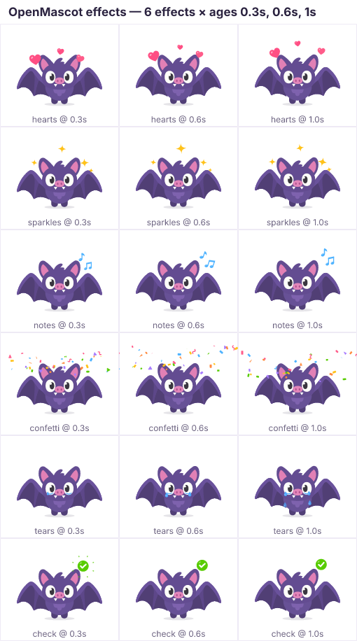

# Effects

Effects are short-lived decorative particles drawn around the mascot —
hearts for love, notes for singing, sweat for nerves, confetti for a
celebration. They punctuate an emotion the way comic-book symbols do.



*`npx tsx packages/cli/src/fx-sheet.ts hearts sparkles notes confetti tears check --ages 0.3,0.6,1.0`*

## Using effects

```ts
mascot.emit('hearts');                                    // at the default anchor
mascot.emit('notes', { at: 'head', params: { side: -1, count: 4 } });
mascot.emit('puff', { at: [0, 0] });                      // absolute character coordinates
```

Or from a clip, timed to the accent frame:

```ts
events: [{ t: 0.45, effect: 'sparkles', at: 'head', params: { count: 5 } }],
```

- **`at`** is an anchor name from the character's `anchors` (e.g. Echo's
  `head` = the head bone 10 units up), any bone name, or an absolute
  `[x, y]` in character units. Omitted → the effect's `defaultAnchor`.
- **`params`** are effect-specific (see the table). Unknown params are ignored,
  bad values fall back to defaults.
- Effects that **follow** (sweat, tears, question marks…) stay attached to
  their anchor bone as it moves; the others are emitted at a fixed point.
- `new Mascot(def, { effectScale: 1.5 })` scales every effect;
  `mascot.clearEffects()` removes all live particles.
- In React: `ref.current?.emit('hearts')`; on the custom element:
  `el.emit('hearts')`. Clip events fire `{ type: 'effect', clip, effect }` on
  `mascot.on(...)` / `mascot:effect` DOM events.

Clip events fire **exactly once per loop iteration** (including events at
`t = 0`), only for the clip that is fading *in* or dominant, and not at all
after a clip has been replaced.

## Built-in effects

Common params where they make sense: `count`, `color` (CSS colour),
`spread` (placement radius in character units), `size` (multiplier),
`side` (`-1` screen-left, `1` screen-right, `0` both), `duration` (seconds).

| effect | description | default anchor | follows |
|---|---|---|---|
| `hearts` | Big pink hearts pop in around the top of the head, float up with a sway and pop away (love, affection). Params: count, color, spread, size. | `head` |  |
| `heart-burst` | A ring of small hearts bursts outward from the anchor and fades (big love moment, "liked!"). Params: count, color, spread, size. | `head` |  |
| `sparkles` | Gold four-point sparkles of varied sizes pop and twinkle around the head (pride, success, magic). Params: count, color, spread, size. | `head` |  |
| `stars` | Gold five-point stars pop out around the character with a spin and settle, then shrink away (success, level up). Params: count, color, spread, size. | `head` |  |
| `shine` | A soft golden glow with slowly turning rays blooms behind the character (reveal, triumph, special moment). Params: color, size, duration, count (rays). | `[0, -125]` |  |
| `notes` | Light-blue eighth and beamed notes rise beside the head, swinging (singing, humming, dancing). Params: count, color, side, size. | `head` |  |
| `music-burst` | A fan of music notes bursts out around the head and drifts away (song completed, big musical moment). Params: count, color, spread, size. | `head` |  |
| `sweat` | Two light-blue sweat drops flick off the side of the head and fall (nervous, embarrassed, effort). Params: count, color, side, size. | `head` | yes |
| `tears` | Tears well up at the bottom of both eyes and roll down the cheeks (sad, crying). Params: count (per eye), color, size, eyeX/eyeY (eye centre relative to the anchor), duration. | `head` | yes |
| `burst` | Two pairs of short, thick yellow excitement strokes flash out above the ears (surprise, excitement, "aha!"). Params: color, spread, size, side (0 = both). | `head` | yes |
| `anger` | A red comic anger-vein mark throbs at the upper corner of the head (grumpy, annoyed). Params: color, side, size, duration. | `head` | yes |
| `confetti` | Colourful confetti (strips, dots, triangles, squiggles) bursts up from around the character, then flutters and tumbles down (celebration). Params: count, color, spread, size. | `[0, -110]` |  |
| `zzz` | Purple Z letters drift up and away from the head, growing as they go (sleeping). Params: count, color, side, size. | `head` |  |
| `dizzy` | Little gold stars circle above the head on a tilted orbit (dizzy, dazed). Params: count, color, spread, size, duration. | `head` | yes |
| `puff` | Chunky dust clouds billow out sideways from the feet and dissolve (landing, stomping, dashing off). Params: count, color, spread, size, side (0 both). | `[0, 0]` |  |
| `question` | A purple question mark pops up beside the head and bobs (confused, curious). Params: color, side, size, duration. | `head` | yes |
| `exclaim` | An orange exclamation mark jolts up beside the head with a quick shake (alert, surprise). Params: color, side, size, duration. | `head` | yes |
| `bubble` | A round speech bubble pops up beside the head with three dots bouncing in sequence (thinking, typing…). Params: color (bubble), dotColor, side, size, duration. | `head` | yes |
| `check` | A green check-mark badge pops in above the head with a spin and a ring of tiny rays, floats and fades (correct answer!). Params: color, side, size, duration. | `head` | yes |
| `xp` | A gold "+10" (drawn with strokes, no fonts) pops up above the head with two sparkles and rises away (XP gained). Params: color, side, size, duration. | `head` |  |
| `speed-lines` | Horizontal motion streaks zip out from the trailing side of the character in quick waves (dashes, fast moves, spins). Params: side (side the streaks trail on: -1 left, 1 right, 0 both), count (per wave), color, size, spread, duration. | `body` | yes |
| `wind` | Curly wind swooshes peel off the wing tips and sweep outward-down (wing flaps, take-off, gusts). Params: side (0 both, -1/1 one wing), count (per side), color, size. | `body` |  |

The source of truth is `packages/core/src/effects-library.ts`; `pnpm openmascot list echo`
prints the current list. Review them all with the effects sheet:

```bash
npx tsx packages/cli/src/fx-sheet.ts                 # every effect × 5 ages → out/sheets/effects.png
npx tsx packages/cli/src/fx-sheet.ts hearts confetti --ages 0.2,0.5,1
```

## How effects work

```
 emit / clip event
   │  resolve anchor → origin (and bone to follow), world angle of the anchor bone
   │  sub-seed from the mascot's RNG
   ▼
 EffectDef.spawn(ctx) ──▶ ParticleSpec[]  { markup, delay, life, at(u, age), behind }
   │
   ▼  every update
 particleFrame(p, now, origin)  ──▶ ParticleFrame { id, markup, transform, opacity, behind }
   │                                 (null before `delay`, removed after `life`)
   ▼
 renderers draw `behind` particles under the character, the rest on top
```

Particles are **analytic**: `at(u, age)` is a pure function of the particle's
normalised age `u ∈ [0, 1]` (and absolute age in seconds). There is no
physics state, so effects are deterministic for a seed, cost almost nothing,
and can be sampled at any time (frame sheets, scrubbing, video export).

## Writing a custom effect

```ts
import { Mascot, fadeEnvelope, num, popEnvelope, str, type EffectDef } from '@openmascot/core';

const bubbles: EffectDef = {
  name: 'bubbles',
  description: 'Soap bubbles wobble upward and pop.',
  defaultAnchor: 'head',
  follow: false,
  spawn: ({ random, params, scale }) => {
    const count = num(params.count, 4);
    const color = str(params.color, '#9ad8ff');
    return Array.from({ length: count }, (_, i) => {
      const x0 = (random() - 0.5) * 80 * scale;
      const r = (6 + random() * 8) * scale * num(params.size, 1);
      const rise = (80 + random() * 60) * scale;
      return {
        markup: `<circle r="${r}" fill="none" stroke="${color}" stroke-width="2"/>`,
        delay: i * 0.1,
        life: 1.2 + random() * 0.4,
        at: (u: number, age: number) => ({
          x: x0 + Math.sin(age * 6 + i) * 6 * scale,
          y: -u * rise,
          scale: popEnvelope(u, 0.15, 0.1),
          opacity: fadeEnvelope(u, 0.1, 0.2),
        }),
      };
    });
  },
};

const m = new Mascot(character, { effects: { bubbles } });  // merged over the built-ins
m.emit('bubbles', { params: { count: 6 } });
```

Rules of thumb:

- **Use only `ctx.random`** for randomness (never `Math.random`) to keep
  determinism.
- Draw markup **centred on (0, 0)** in character units; the runtime positions,
  rotates and scales it. Sizes are tuned for a head ~150 units wide.
- Keep markup small and flat: no filters, no fonts (draw glyphs as paths), a
  couple of white gloss highlights at most. Markup must be well-formed XML.
- `ParticleState` fields: `x`, `y` (offset from the anchor), `rot` (deg),
  `scale` or `sx`/`sy`, `opacity` (clamped to 0..1).
- `ctx.angle` is the anchor bone's world rotation at emission — handy for
  directional effects; `ctx.scale` is the global `effectScale`.
- Helpers: `popEnvelope(u, in, out)` (springy pop in/out scale),
  `fadeEnvelope(u, in, out)` (linear opacity in/out), `num()`/`str()` param
  readers, and `SHAPES` (the built-in heart, sparkle, note, drop, star…
  markup generators).
- Set `behind: true` on a spec to draw it under the character (glows, dust).

Add a built-in effect to `packages/core/src/effects-library.ts` and the
`builtinEffects` registry; the test suite automatically checks every built-in
spawns well-formed, finite, deterministic particles.
