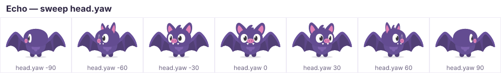
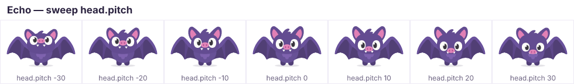
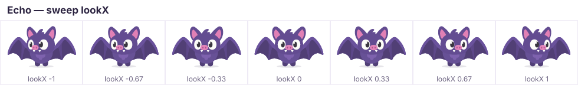

# Pseudo-3D (2.5D)

OpenMascot characters are drawn **once, from the front**, as flat SVG. The
solver (`packages/core/src/solve.ts`) fakes the third dimension with a few
cheap, robust rules — the classic flat-vector "2.5D" trick used in mobile
games and brand animation. The result: a single drawing can spin 360°, look
around and nod.


*`pnpm framesheet echo --sweep root.yaw --range 0,330` — note the wings swapping in
front of the body from behind, the face fading out past ~90°, the back
markings appearing, and the wings mirroring.*

## The model in one picture

```
 side view (looking down the y axis)            what the solver keeps
                                                 
        camera                                   ┌───────────────────────────┐
          ▲  +z (toward viewer)                  │ x', y'  → 2D parallax     │
          │                                      │ z'      → depth sorting   │
   nose ● │ z=+66                                │           + perspective   │
   eye  ●─┼─ z=+40          rotate offsets       │ facing  → foreshortening, │
  head  ◉─┼─ pivot           by yaw / pitch      │           culling, mirror │
   ear  ●─┼─ z=−6          ───────────────▶     └───────────────────────────┘
  wing  ●─┼─ z=−20
          │
```

Every bone pivot has a **3D offset from its parent pivot**:
`(dx, dy)` read from the drawing (absolute pivots, rest pose) and `z` from
`data-om-z` (positive = toward the viewer). Nothing else about the art is 3D.

## Yaw, pitch and parallax

Two bone channels rotate a subtree in 3D:

| channel | axis | sign |
|---|---|---|
| `yaw` | vertical | `+` turns toward screen-right |
| `pitch` | horizontal | `+` nods down |

Rotations **accumulate** down the tree (`root.yaw` + `body.yaw` + `head.yaw`).
For each child, the solver rotates its offset by the parent's accumulated
yaw, then pitch:

```
x₁ =  dx·cos(yaw) + z·sin(yaw)        y₂ =  dy·cos(pitch) + z₁·sin(pitch)
z₁ = −dx·sin(yaw) + z·cos(yaw)        z₂ = −dy·sin(pitch) + z₁·cos(pitch)
```

The projected 2D shift `(x₁ − dx, y₂ − dy)` is added to the child's
translation. So when the head turns right, the eyes and snout (in front of the
head pivot) slide right, the ears (behind) slide left — **parallax** — and a
child's pivot sweeps around an ellipse as the parent spins.





The depth `z₂` is used for sorting and perspective (below). The bone that
*owns* the yaw does not move; only its descendants do.

## Surfaces: how the flat art itself reacts

Rotating offsets moves parts around, but each part is still flat art. A bone's
`data-om-surface` decides how its art is distorted, based on its facing angle
`yaw + normalYaw` (and `pitch + normalPitch`), where `data-om-normal="yaw pitch"`
is the direction the surface faces at rest (an eye on the left of a round head
faces slightly left, e.g. `-25 0`).

| surface | foreshortening | visibility | use for |
|---|---|---|---|
| `volume` (default) | none | always | round heads, bodies, feet — anything that looks the same from all sides |
| `flat` | `x` scaled by `cos(facing yaw) / cos(normal yaw)` (same for pitch on `y`) — **negative from behind, i.e. mirrored** | fades out only when edge-on (|cos| < ~0.2) to avoid slivers | wings, ears, fins, tufts, flags |
| `face` | mild: `lerp(1, cos-ratio, faceForeshorten)` (default 0.85), clamped at 0 | **fades out as it turns away** (smoothstep on `cos(yaw)·cos(pitch)` from 0.32 down to 0.02) | eyes, mouth, blush, belly patch, inner ears |
| `back` | like `face` | like `face`, but faces **backwards** (normal + 180°): visible only from behind | back markings, the back of the head |
| `feature` | like `face` but never below 40 % | **never culled**; relies on depth sorting so the parent's art hides it | snouts, beaks, noses, horns — things that stick out in profile |

Foreshortening is **not compounded**: a `face` bone inside a `flat` bone has
its parent's factor divided back out.

## Depth sorting

Within each container (bone, layer, or visible slot variant), children are
drawn in order of projected depth:

- the container's **own art** sits at depth 0;
- child bones use their rotated `z₂` plus their `dz` channel;
- layers and slots use their rotated `data-om-z`;
- ties keep document order (stable sort);
- `face` bones with `z > 0` never sort behind their parent's own art
  (culling, not sorting, hides them when the head turns away).

At rest everything is in document order (the rig validator warns if your
document order disagrees with `z`). When Echo turns around, `wing-l` at
`z = −20` ends up at `+20` and is drawn in front of everything else:

```
 Echo's body, rest (yaw 0)          from behind (root.yaw 180)
  back ─▶ front                      back ─▶ front
   wing-l     z −20                   head       (now −4)
   wing-r     z −20                   body art   (0)
   body-back  z −12                   belly      (face: culled, kept in front of the art)
   foot-l/r   z −6       ──▶          foot-l/r   (now +6)
   body art   0                       body-back  (now +12, visible)
   head       z +4                    wing-l/r   (now +20, mirrored)
   belly      z +40
```

When a container's order differs from document order, the solver writes the
permutation to `Frame.order` and renderers re-order the DOM (or the string).

## Perspective

A weak perspective term scales each bone by how much closer to (or farther
from) the camera it is **compared to the rest pose**:

```
k = ((f − d_parent) / (f − d_bone)) · ((f − r_bone) / (f − r_parent))
```

with `f = focal` (default 900 character units; `solve: { focal: 0 }`
disables it), `d` the current depth and `r` the rest depth. At rest `k = 1`,
so **the rest pose renders exactly like the source drawing**. A snout that
turns away gets slightly smaller, a head that leans in with `dz` gets bigger.

## Recipes

| effect | how |
|---|---|
| full spin | `root.yaw` 0 → 360 (add squash/stretch); blending uses the shortest angle, so leaving a spin held at 360° doesn't unwind |
| look around | the `lookX` / `lookY` params (Echo: head yaw ±24°, pupils lead) |
| nod | `head.pitch` (Echo's `nod-yes`) |
| lean in toward the viewer | `dz` + a little `sx/sy` |
| 3/4 view pose | hold `root.yaw` around 25–35° (see Echo's `fly-side`) |

## Designing art that turns well

1. **Give every part a believable `z`.** Measure it like a sculptor: how far in
   front of / behind its parent's pivot is it? Echo: eyes `+40`, mouth `+45`,
   snout `+66`, ears `−6`, wings `−20`, head-back `−30`.
2. **Keep document order = z order.** Back to front. The SVG then previews
   exactly like the engine's rest pose.
3. **Round things are `volume`.** Heads and bodies drawn as circles/blobs look
   right from every angle; avoid strong directional shading baked into them.
4. **Paint the face as separate `face` bones.** Eyes, mouth, blush and belly
   patch should be their own bones so they can slide (parallax) and cull.
   Give side features a `data-om-normal` (eyes at `±20…30`) so the near eye
   stays fuller than the far one.
5. **Protrusions are `feature`s.** A snout/beak/nose with high `z` keeps its
   silhouette in profile and is hidden by the head once it rotates behind.
6. **Thin appendages are `flat`.** Wings, ears and tufts foreshorten and mirror
   — draw them so their mirror image still reads (symmetric veins, no text).
7. **Add a back.** A `back` surface (darker patch, wing-joint details, the
   back of the head) sells the turn-around; without it the back view is just
   the silhouette.
8. **Pivots at joints, not centres.** Wing pivot at the shoulder, ear pivot at
   its base, head pivot at the neck. Parallax and rotation both use pivots.
9. **Review with sweeps**, every time you change z, normals or surfaces:

   ```bash
   pnpm framesheet echo --sweep root.yaw --range 0,330
   pnpm framesheet echo --sweep head.yaw --range -90,90 --frames 7
   pnpm framesheet echo --sweep head.pitch --range -30,30 --frames 7
   pnpm framesheet echo --param lookX --range -1,1 --frames 7
   ```

   

## Limits

It's a trick, not a 3D engine: parts never deform beyond affine
foreshortening, silhouettes don't change, and very large pitches (> ~40°)
look cardboard-like. Keep big turns quick (spins) or partial (looks, 3/4
poses), and let squash, springs and effects carry the motion.
