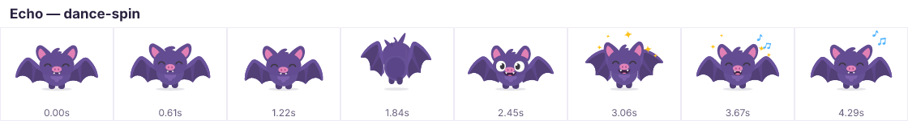
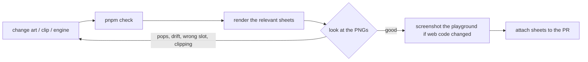

# Testing and visual review

Animation quality can't be fully unit-tested, so OpenMascot uses three
layers of checks:

1. **Unit tests** (Vitest) — the engine's maths, data validity, determinism.
2. **Frame sheets** — contact sheets rendered by the real engine, for humans
   and multimodal AI reviewers.
3. **Screenshots** of the running playground, for the browser path.

## 1. Unit tests

```bash
pnpm test                                  # everything (vitest run)
pnpm test:watch                            # watch mode
pnpm vitest run packages/core/test/solve   # one file / pattern
pnpm vitest run -t "blink"                 # by test name
pnpm check                                 # embed --check + typecheck + test (run before pushing)
```

Config: `vitest.config.ts` at the repo root. Tests live in
`packages/<pkg>/test/**/*.test.ts(x)` and import packages through the
`@openmascot/*` aliases (source, no build needed). The default environment is
Node; DOM tests opt into [happy-dom](https://github.com/capricorn86/happy-dom)
with a first-line comment:

```ts
// @vitest-environment happy-dom
```

### What is covered

| file | covers |
|---|---|
| `core/test/xml.test.ts` | parse/serialise round trip, comments/CDATA/declarations, entities, every parse error (with line numbers) |
| `core/test/rig.test.ts` | bones, pivots (incl. inherited), z, surfaces, normals, springs/tips, shadow, attribute stripping, art grouping, layers, slots/variants/defaults, bones inside variants, recolour, `describeRig`, every warning and every error |
| `core/test/mat.test.ts` | matrix product order, inverse, pivot rotation/scale, angle/scale extraction, formatting |
| `core/test/ease.test.ts` | every ease's endpoints, monotonicity/bounds, overshoot, `cubicBezier` vs CSS values, `resolveEase` caching/errors |
| `core/test/clip.test.ts` | key sampling (holds, eases, step, bezier, binary search), beats/bpm, expression & slot steps, `fn` hooks, `lintClip` |
| `core/test/pose.test.ts` | blend (rest fill, shortest-angle, discrete switch), additive layering, `wrap180`, `piecewise`, `resolvePose` (drivers, curves, clamping, expressions, neutral, unknown-variant fallback) |
| `core/test/solve.test.ts` | **Echo at rest is the drawing** (every visible bone's local matrix is identity), parallax, pitch, 360° = rest, face culling & gradual fade, flat foreshortening/mirroring/edge-on fade, depth re-ordering of the wings at 180°, perspective, stable sort permutations |
| `core/test/mascot.test.ts` | crossfade weights, cuts, `fadeIn`, one-shot → idle, `then`, `then: null`, `repeat`, `loop` events, `speed`, `bpm`, clip events exactly once per loop (incl. `t = 0`, several `dt`s), effect spawn/expiry/anchors/follow, expression override & duration, **blink-masked eye swaps**, look-at easing, shadow, autonomous blinks & fidgets, **determinism** (same seed → identical SVG for 360 frames), springs settle |
| `core/test/effects.test.ts` | `rng`, envelopes, particle transforms/lifetime, and for **every built-in effect**: valid well-formed markup, finite states, determinism, params |
| `core/test/author.test.ts` | `cycle`, `keys`, `wave`, `mirrorClip` (and its inverse), `sequence` (rest keys, discrete resets, `fn` windows) |
| `core/test/render-string.test.ts` | output parses as XML, hidden variants/culled bones omitted, transforms/opacity, padding/size/background, particle layering, every Echo expression |
| `characters/test/echo.test.ts` | Echo compiles with zero warnings, embed is up to date, left/right symmetry, rest = drawing, palette, every expression → real slots/variants, every param → real bones, anchors, idle/fidgets |
| `characters/test/library.test.ts` | **every clip** Echo can play: `lintClip` clean, description + category, effects/anchors/expressions/slot variants exist, plays to the end with finite frames and no warnings |
| `web/test/dom-renderer.test.ts` | DOM structure, defs, fx layers, one group per bone, variant visibility, transform/opacity diffing, depth re-ordering and restore, particles add/update/remove |
| `web/test/player.test.ts` | `MascotPlayer` mount/step/loop/destroy, `<open-mascot>` attributes, events and errors |
| `react/test/mascot.test.tsx` | `<Mascot>` mount/unmount, imperative handle, `animation`/`expression` props, character change |

New clips and effects are covered automatically: the library test iterates
every clip, and the effects test iterates every built-in effect.

### Writing tests

- Prefer `alive: false` and an explicit `seed` so tests are deterministic.
- Step with `dt = 1/64` when you assert on loop boundaries (exact in binary
  floating point).
- `packages/core/test/fixtures.ts` has a small hand-written test character
  (`testCharacter`) with every node kind — use it for engine behaviour, and
  Echo for "real character" checks.
- For rendering assertions, parse `renderSvg` output with `parseXml` rather
  than matching strings.

## 2. Frame sheets

Frame sheets render N frames of a clip, sweep or expression set into one PNG
via [resvg](https://github.com/yisibl/resvg-js) — no browser needed.

```bash
pnpm framesheet echo emote-love --frames 12            # → out/sheets/echo-emote-love.png
pnpm framesheet echo wave --from idle --hold 0.6        # include the crossfade from idle
pnpm framesheet echo dance-bop --per-beat 2             # sample twice per beat
pnpm framesheet echo dance-bop --bpm 90 --start 2 --duration 2
pnpm framesheet echo idle --alive --duration 6          # with blinks/glances (seeded)
pnpm framesheet echo --expressions                      # every expression
pnpm framesheet echo --sweep root.yaw --range 0,330     # 3D turn-around
pnpm framesheet echo --param flap --range -1.5,1.5      # param range
npx tsx packages/cli/src/fx-sheet.ts hearts confetti    # effects × ages
pnpm openmascot render echo --clip wave --time 0.6 --out out/wave.png
```

Sheets are deterministic (fixed seed, `alive: false` unless `--alive`), so
before/after sheets can be diffed. Examples:



## 3. Screenshots

`scripts/screenshot.mjs` drives the preinstalled Chromium through
`playwright-core` (it looks in `/opt/pw-browsers`, or set `CHROMIUM_PATH`):

```bash
pnpm dev &                                                  # playground on :5173
node scripts/screenshot.mjs http://localhost:5173 out/pg.png --width 1280 --height 800 --wait 1500
node scripts/screenshot.mjs http://localhost:5173 out/pg.png --frames 6 --interval 250   # a burst
node scripts/screenshot.mjs http://localhost:5173 out/pg.png --click 'text=Dance' --full
```

It prints any page errors and console errors, which makes it a cheap smoke
test of the browser runtime.

## Visual review workflow

For every change that affects how a character looks or moves:



1. `pnpm check` (and `pnpm openmascot lint echo`).
2. Render the sheets that exercise the change: the clip you touched (and
   `--from idle` for its transition), sweeps for rig/solver changes, the
   expression sheet for face art, the fx sheet for effects.
3. Look at them. Things to catch: parts popping in front/behind mid-turn,
   pupils leaving eyes, limbs detaching at extremes, effects clipped by the
   tile (raise `--padding`), timing that feels floaty (hold key poses
   0.15–0.4 s), events on the wrong frame.
4. For web changes, screenshot the playground and check the console output.
5. Attach the before/after sheets to the pull request. CI also uploads a
   sweep and the expression sheet as build artifacts for every run.

AI agents: you can read the PNGs directly — make the review loop part of
your task, not an afterthought (see [AGENTS.md](../AGENTS.md)).
